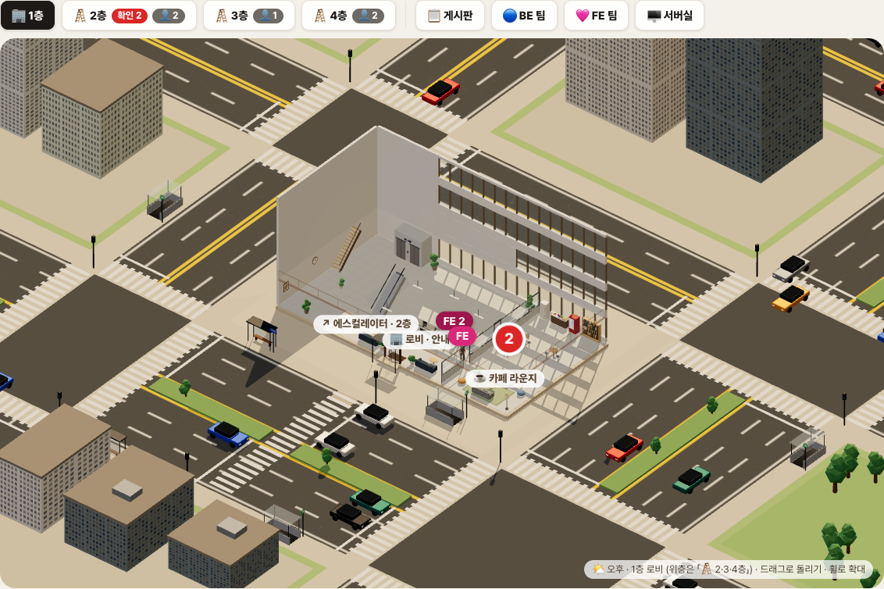
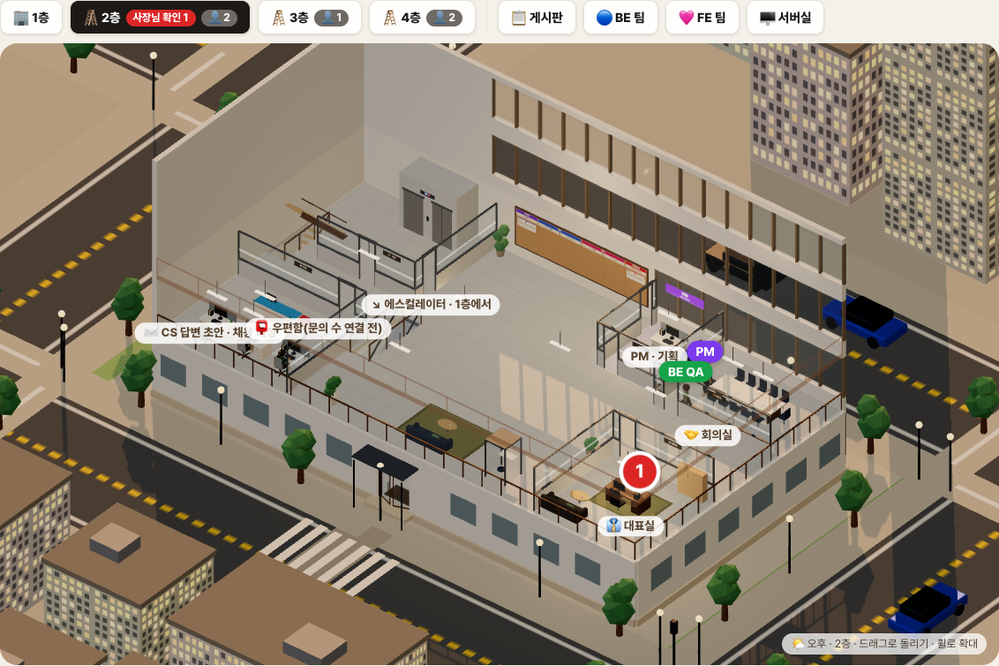
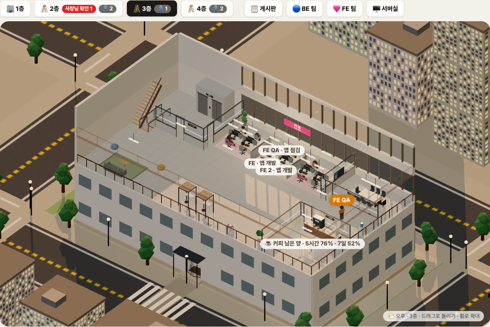
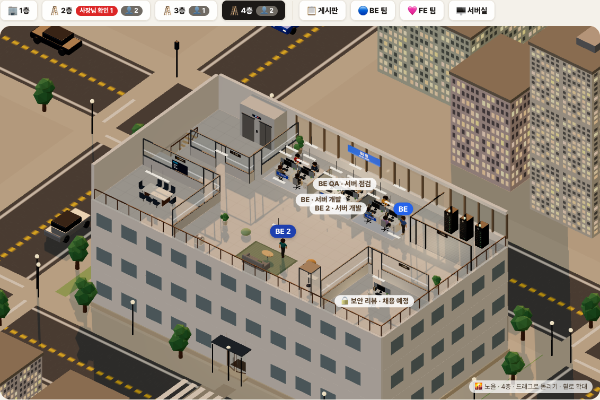
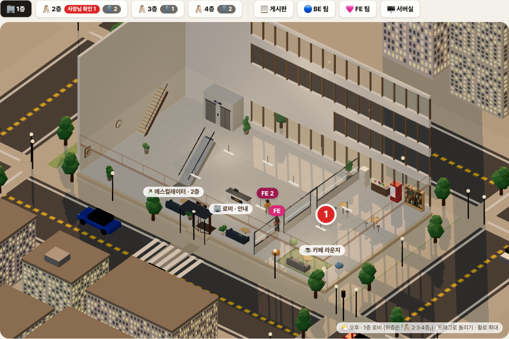
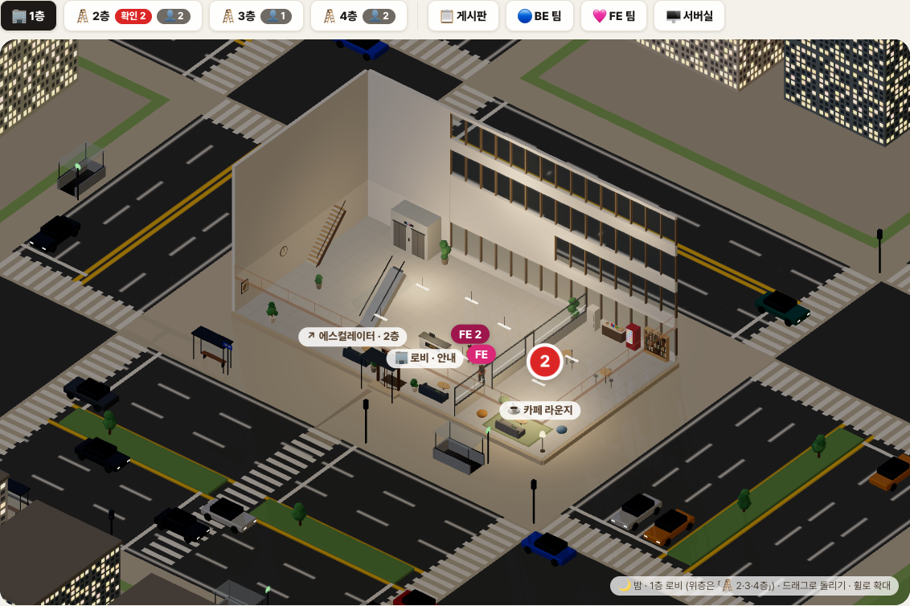
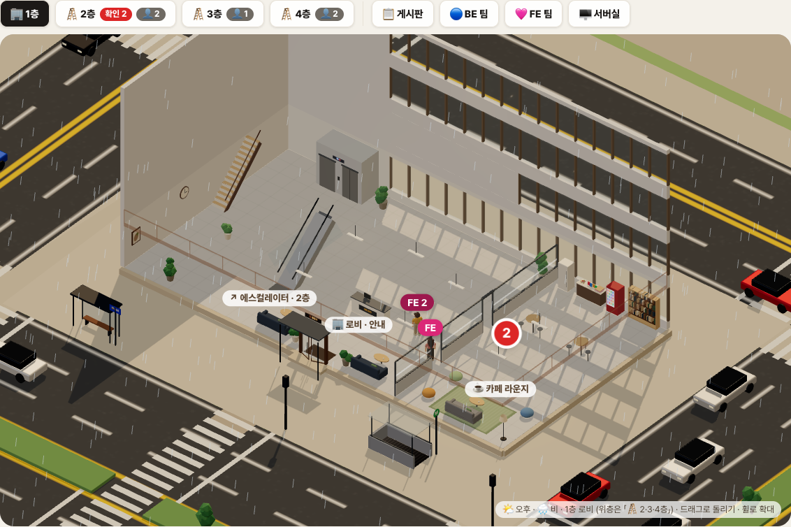

# 에이전트 사무실 — AI 에이전트가 일하는 모습을 3D 건물로, 운영 서버 상태는 서버실 랙으로

> 2026-10-19 ~ 10-23. [AI 에이전트 개발 파이프라인](./agent-pipeline.md)을 돌리기 시작하자 대표가 물었다. 「지금 누가 무슨 일 하고 있어?」
> 답하려면 터미널 로그를 열어야 했다. 그래서 **에이전트가 일하는 모습을 그대로 보여 주는 사무실 화면**을 만들었다. 사무실은 4층 건물이고,
> 에이전트는 자기 자리에 앉아 일한다. 일이 생기면 다른 팀 자리나 회의실로 걸어간다. 4층 서버실의 랙 3대는 실제 운영 서버 상태를 보여 준다.
> 데이터는 [모니터링 스택](../ops/monitoring-infra.md)(Prometheus·Loki·Uptime Kuma)에서 읽는다.
> 이 문서는 구성, 데이터 연결, 직원 3D 모델을 만든 방법을 정리한다.



## 목차

1. [무엇을 보여 주나](#1-무엇을-보여-주나)
2. [전체 구조](#2-전체-구조)
3. [바닥 — claude-office 위에 얹기](#3-바닥--claude-office-위에-얹기)
4. [건물 — 4층, 층마다 역할](#4-건물--4층-층마다-역할)
5. [사람 — 에이전트 7명과 직원 18명](#5-사람--에이전트-7명과-직원-18명)
6. [서버실 — PLG·Uptime Kuma 연동](#6-서버실--plguptime-kuma-연동)
7. [탕비실 커피머신 — 에이전트 사용량](#7-탕비실-커피머신--에이전트-사용량)
8. [바깥 — 강남식 도로·버스·지하철·날씨](#8-바깥--강남식-도로버스지하철날씨)
9. [3D 모델 — GPT 로 절차적 생성](#9-3d-모델--gpt-로-절차적-생성)
10. [맥 mini 한 대에서 가볍게 돌리기](#10-맥-mini-한-대에서-가볍게-돌리기)
11. [점검 방법](#11-점검-방법)
12. [오더와 카드 — 라벨이 곧 상태다](#12-오더와-카드--라벨이-곧-상태다)
13. [밟은 함정](#13-밟은-함정)

---

## 1. 무엇을 보여 주나

| 화면에서 보이는 것 | 실제 의미 |
|---|---|
| 에이전트가 자리에 앉아 타이핑하고 머리 위에 말풍선이 뜬다 | 그 역할의 Claude 세션이 지금 도구를 쓰는 중이고, 말풍선은 지금 하는 일(「`OrderService.java` 수정」「테스트 실행」) |
| 에이전트가 2층 대표실 서류함으로 걸어간다 | 사람 승인이 필요한 카드가 생겼다(PR 머지·기획 질문) |
| 층 버튼의 빨간 배지 「확인 2」 | 승인 대기 카드 수 |
| 4층 서버실 랙의 경광등이 주황·빨강으로 바뀐다 | 운영 서버 5xx·응답 지연·DB 연결 포화(§6) |
| 3층 탕비실 커피머신 「커피 남은 양 · 5시간 76% · 7일 52%」 | 에이전트 계정의 남은 사용량(§7) |
| 직원 18명이 일하고 커피를 마시고 회의실에 다녀온다 | 장식. 에이전트가 쉬는 동안에도 사무실이 비어 보이지 않게 |
| 바깥에 차·버스가 다니고 가끔 비·눈이 온다 | 장식(§8). 운영 데이터와는 무관 |

화면 오른쪽에는 운영 패널이 붙어 있다. 오더 넣기(평소 말투로 요청을 쓰고 캡처를 붙이면 PM 에이전트가 이슈로 만든다), PM 자율 점검, 일하는 중인 에이전트와의 대화창, 「사장님이 볼 것」·「진행 중」·「⏸ 보류」 목록이 있다. 이 문서는 왼쪽 3D 화면과 그 뒤 데이터 연결을 주로 다루고, 패널 쪽은 §12 에서 라벨 상태 관리만 다룬다.

## 2. 전체 구조

```
┌──────────────── Mac mini (에이전트 러너, 사무실 랜) ─────────────────┐
│                                                                      │
│  역할별 일꾼(worker.sh) ── claude -p ──▶ Claude 세션(pm·be·be2·qa·fe·fe2·qafe)
│        │ busy-<역할> 잠금 파일                │ 훅(이벤트)             │
│        ▼                                     ▼                       │
│  ~/work/locks/                     claude-office 백엔드(FastAPI, 127.0.0.1:8000)
│                                       ├ visualizer.db  ← 세션 이벤트  │
│                                       ├ mildo_office.py  (우리 패치)  │
│                                       │   /api/v1/mildo/office    누가·무엇을
│                                       │   /api/v1/mildo/servers   운영 상태 ──┐
│                                       │   /api/v1/mildo/accounts/usage 사용량│
│                                       └ mildo_office.html (Three.js 3D)      │
└──────────────────────────────────────────────────────────────────────│───┘
                                                                       │ 사설망
                             ┌──────── 모니터링 서버(사무실 PC) ◀─────┘
                             │  Prometheus · Loki · Uptime Kuma · Grafana
                             └──────── ◀── 운영 서버의 수집기(Alloy)가 push
```

- 화면은 HTML 파일 한 장이다(Three.js, 빌드 없음). 2.5초마다 `/api/v1/mildo/office`(누가 무엇을), 10초마다 `/orders`(이슈 카드), 30초마다 `/servers`(운영 상태)를 부른다.
- 운영 서버에는 직접 붙지 않는다. **에이전트 러너에는 운영 접근 수단을 두지 않는다**는 파이프라인 원칙을 지키려고, 이미 운영 지표가 모이는 모니터링 서버만 읽는다.
- 화면은 `127.0.0.1` 에서만 열린다(원본의 LocalhostOnly 미들웨어). 바깥에서 보려면 사설망을 거쳐야 한다.

## 3. 바닥 — claude-office 위에 얹기

밑바탕은 오픈소스 [claude-office](https://github.com/paulrobello/claude-office)(MIT)다. Claude Code 훅으로 세션 이벤트(도구 호출·서브에이전트·종료)를 받아 SQLite 에 쌓고, 픽셀 사무실로 보여 준다.

이것을 그대로 쓰지 않고 **백엔드만 빌렸다.**

- 원본 화면은 세션마다 방이 하나씩 생기는 구조다. 역할이 고정된 팀(PM·BE 2·QA·FE 2·FE QA)을 보여 주기에는 맞지 않았다. 화면은 새로 만들고, 예전 주소(`/building`·`/floor/…`)는 새 화면으로 넘긴다.
- 원본은 **커밋 해시로 고정**하고, 설치 스크립트가 고정본을 받은 뒤 우리 패치 파일(`mildo_office.py`·`.html`·`mildo_orders.py`)을 라우트 폴더에 복사한다. 원본이 바뀌어도 우리 화면은 깨지지 않는다.
- 원본의 AI 요약 기능은 껐다. 이벤트마다 요약을 만들면 에이전트와 같은 사용량을 쓴다.
- 역할 판정은 세션의 작업 폴더 이름으로 한다. 일꾼이 역할마다 `~/work/agents/<역할>` 에서 `claude` 를 띄우므로, 훅 이벤트의 `project_name` 이 곧 역할이 된다.

`GET /api/v1/mildo/office` 응답(요약):

```json
{
  "now": "2026-10-23T08:30:00+00:00",
  "roles": {
    "be": { "job": { "mode": "work", "issue": 75 }, "working": true, "activity": "OrderService.java 수정",
            "startedAt": "…", "lastAt": "…", "steps": 42, "model": "claude-sonnet-…" },
    "qa": { "job": null, "working": false }
  },
  "log": [ { "at": "…", "role": "be", "type": "start" } ],
  "alerts": []
}
```

- 「지금 무슨 일을 잡았나」(`job`)와 「지금 손을 움직이나」(`working`)를 따로 본다. `job` 은 일꾼이 일을 잡을 때 `~/work/locks/busy-<역할>` 에 쓰는 「모드 #번호 PID」이고, **PID 가 살아 있을 때만** 인정한다(`os.kill(pid, 0)`). `working` 은 훅 DB 의 그 역할 최근 세션에 종료 이벤트가 없고 마지막 이벤트가 10분 안일 때다. 세션이 죽으면 종료 이벤트가 빠질 수 있어서 시간 창을 같이 둔다.
- 훅 DB 는 **읽기 전용**(`file:…?mode=ro`)으로 연다. 원본 백엔드가 쓰는 중에 화면 쪽 조회가 잠금을 잡지 않게 하려는 것이다.
- `activity` 는 마지막 도구 호출을 사람 말로 바꾼 것이다. `Edit` 이면 「파일명 수정」, `Bash` 의 `mvn test` 면 「테스트 실행」이 된다. 경로는 앞을 잘라 28자로 줄인다.

## 4. 건물 — 4층, 층마다 역할

건물은 30×16m 4층, 층고 3.4m다. 층 버튼을 누르면 그 층보다 위는 숨기고 윤곽선만 남겨, 위에서 내려다보는 시점을 만든다.

| 층 | 공간 |
|---|---|
| 1층 로비 | 출입구·안내 데스크·카페 라운지·엘리베이터 2대·1→2층 에스컬레이터 |
| 2층 경영 | 칸반 게시판(벽면)·PM실·12석 회의실·대표실·CS팀 |
| 3층 FE팀 | 4인 마주 보기 섬 3개(개발 1파트·에이전트·개발 2파트)·FE 회의실·탕비실 |
| 4층 BE팀 | 같은 섬 구성·서버실(랙 3대)·보안팀 자리·소회의실 |

| 2층 경영 | 3층 FE팀 |
|---|---|
|  |  |

| 4층 BE팀·서버실 | 1층 로비 |
|---|---|
|  |  |

만들면서 정한 것들:

- **바닥은 걸을 수 있는 칸(격자)이다.** 층마다 0.2m 칸으로 나누고, 벽·책상·소파·파티션을 막힌 칸으로 등록한다. 길은 층 안에서 A*로 찾는다. 다른 층으로 갈 때는 「이 층 A* → 엘리베이터 안 → 목적 층 엘리베이터 앞 → 목적 층 A*」를 이어 붙인다(올라갈 때 왼쪽, 내려갈 때 오른쪽 엘리베이터). 1→2층은 엘리베이터 대신 에스컬레이터 경로를 끼운다.
- **책상에 방향을 줬다.** 처음에는 책상이 모두 한 방향(창 쪽)만 봤다. 4인 섬으로 바꾸면서 `desk(key, x, z, label, y, rot)` 에 회전을 넣고, 「책상 기준 좌표 → 바닥 좌표」 변환 함수 `at(lx, lz)` 를 책상마다 둬서 의자·앉는 위치·「옆에 서서 말 거는 위치(`beside`)」를 모두 이 함수로 구한다. 회전을 나중에 넣으면 상수로 박아 둔 `d.z + 0.95` 같은 좌표가 전부 틀어진다. 그래서 위치 계산을 한 함수로 모았다.
- **엘리베이터 홀을 유리벽과 문으로 막았다.** 2~4층은 엘리베이터에서 내리면 홀이고, 유리문을 지나야 사무 공간이다. 문에는 「3F · FE팀」 안내판이 붙어 있다. 유리벽 사이의 문 칸만 걸을 수 있게 열어 둔다.
- **대표실 책상은 문을 바라본다.** 처음에는 창을 보게 놓았는데, 대표 요청으로 책상 그룹을 π 회전했다. 책상만 돌리면 끝이 아니다. 결재 서류함 위치와 「찾아온 사람이 서는 위치」도 반대편으로 옮겨야, 서류를 든 에이전트가 문과 책상 사이에 선다.

## 5. 사람 — 에이전트 7명과 직원 18명

### 에이전트(PM·BE·BE 2·BE QA·FE·FE 2·FE QA)

이벤트에 따라 움직인다.

| 상태 | 행동 |
|---|---|
| 일을 잡음(`job`) | 2층 게시판으로 가서 그 이슈 카드를 떼어 들고 자기 자리로. 앉아서 타이핑, 말풍선에 「#75 OrderService.java 수정」 |
| 단계가 넘어감(BE 완료 → QA) | 다음 담당 자리로 걸어가 넘기고 돌아옴. 넘긴 기록은 카드 이력에 「🤝 넘김」으로 남음 |
| 사람 승인 필요 | 2층 대표실 서류함에 서류를 올리고 돌아옴 |
| 일이 없음 | **자리에서 일한다.** 20~45초마다 역할에 맞는 혼잣말(BE 「🧪 테스트 보강 중」, FE QA 「📱 에뮬레이터 상태 확인」) |

일이 없을 때 자리를 비우게 했더니 사무실이 늘 텅 비어 보였다. 그래서 기본값을 「자리에서 일하기」로 바꾸고, **2~5분마다 쉬는 행동을 하나** 고르게 했다. 한 번 굴린 난수로 행동을 고른다.

```js
function pickIdle(c){
  const p = idlePartner(c), roll = Math.random(), be = TEAM_Y[c.r] === F4;
  if (roll < 0.26) return () => doWorkVisit(c);                // 일 때문에 다른 자리·다른 층
  if (roll < 0.44) return () => doCoffee(c);                   // 3층 탕비실·1층 카페
  if (roll < 0.54){ const q = idlePartner(c, true); if (q) return () => doMeeting(c, q); }
  if (roll < 0.64) return () => doBoard(c);                    // 2층 게시판
  if (roll < (be ? 0.74 : 0.66)) return () => doServer(c);     // 서버실 점검 — 4층 사람은 10%, 나머지는 2%
  if (roll < 0.80) return () => doNpcVisit(c);
  if (roll < 0.86) return () => doPrinter(c);
  if (roll < 0.91) return () => doBooth(c);
  if (p && roll < 0.97) return () => doChat(c, p);
  return null;                                                 // 이번엔 쉬지 않고 계속 일한다
}
```

구간 폭이 곧 가중치라서, 행동을 하나 넣거나 비율을 바꿀 때 숫자 하나만 고치면 된다. 일하는 중인 에이전트는 이 함수를 타지 않는다.

### 직원 18명(FE 8·BE 8·CS 2)

에이전트가 아닌 **배경 인물**이다. 이름표는 달지 않는다. 대부분 시간은 자기 섬 자리에 앉아 일하고, 3~6분마다 커피·프린터·회의실·동료 자리 중 하나에 다녀온다. 사람마다 첫 출발 시각을 흩어 둬서 한꺼번에 일어나지 않게 했다.

### 이동과 애니메이션

- 모델마다 `idle`·`walk`·`typing`·`wave` 클립이 있다(§9). 걷기는 제자리 걷기 클립을 틀어 두고 위치는 코드가 초속 1.6m 로 옮긴다. 경로를 따라가며 진행 방향으로 몸을 돌린다.
- 앉을 때는 책상 방향(`rot`)으로 몸을 돌리고, `typing` 클립의 앉은 자세에 맞춰 의자를 당긴다. 클립 전환은 0.3초 크로스페이드다.
- 사람끼리 겹치는 것은 막지 않았다. 25명 규모에서는 충돌 회피 비용보다 가끔 겹쳐 보이는 쪽이 싸다고 봤다.

## 6. 서버실 — PLG·Uptime Kuma 연동

4층 서버실의 랙 3대는 운영 서버를 셋으로 나눠 보여 준다.

| 랙 | 보는 것 | 출처 |
|---|---|---|
| 앱 서버(Spring) | 살아 있나, 분당 요청, p95, 5xx(10분·1시간), 힙, 가동 시간, ERROR 로그 수, 외부 생존 확인 | Prometheus(Micrometer), Loki, Kuma |
| DB(앱의 연결) | 활성/최대 연결, 대기, 1시간 타임아웃, 1시간 데드락 | Prometheus(HikariCP), Loki |
| 웹·서버 | nginx 분당 요청·5xx, CPU·메모리·디스크·load | Loki(nginx access), Prometheus(node), Kuma |

랙에는 경광등(초록·주황·빨강), DB 연결 수만큼 켜지는 LED, 도는 팬이 있다. 랙을 누르면 상세 창이 뜨고, 최근 1시간 ERROR 로그 5줄과 Grafana·Kuma 바로 가기가 함께 보인다. 상태는 4층 층 버튼 배지로도 올라온다.

### `GET /api/v1/mildo/servers`

PromQL 16개, LogQL 4개, Kuma 1개, 최근 ERROR 로그 조회 1개를 **스레드 12개로 동시에** 던지고 결과를 30초 캐시한다. 화면 여러 개가 열려 있어도 모니터링 서버에는 30초에 한 묶음만 간다.

```python
_APP, _REQ, _NODE = 'job="mildo-spring"', 'job="mildo-spring",uri!~"/actuator.*"', 'instance="mildo-prod"'
SRV_Q = {
    "up":      f"up{{{_APP}}}",
    "rpm":     f"sum(rate(http_server_requests_seconds_count{{{_REQ}}}[5m]))*60",
    "e5_10m":  f'sum(increase(http_server_requests_seconds_count{{{_REQ},status=~"5.."}}[10m]))',
    "p95":     f"histogram_quantile(0.95, sum by (le) (rate(http_server_requests_seconds_bucket{{{_REQ}}}[5m])))",
    "dbActive":f"max(hikaricp_connections_active{{{_APP}}})",
    "dbPending":f"max(hikaricp_connections_pending{{{_APP}}})",
    "cpu":     f'1 - avg(rate(node_cpu_seconds_total{{mode="idle",{_NODE}}}[2m]))',
    # … 힙·가동 시간·DB 타임아웃·메모리·디스크·load
}
LOKI_Q = {
    "err1h":      'sum(count_over_time({job="mildo-app",level="ERROR"}[1h]))',
    "deadlock1h": 'sum(count_over_time({job="mildo-app",level="ERROR"} |= "Deadlock found" [1h]))',
    "ngxRpm":     'sum(count_over_time({job="nginx-access"}[5m])) / 5',
    "ngx5xx1h":   'sum(count_over_time({job="nginx-access"} |~ "\\" 5[0-9][0-9] " [1h]))',
}
```

- **관리용 요청은 뺀다**(`uri!~"/actuator.*"`). 지표 수집·헬스체크 요청까지 세면 사람이 없는 시간에도 요청이 있는 것처럼 보이고, 빠른 요청이 섞여 p95 가 실제보다 낮아진다.
- **Loki 결과가 비면 0, Prometheus 결과가 비면 `null`** 로 구분한다. 로그가 없다는 것은 「오류 0건」이지만, 지표가 없다는 것은 「수집이 끊겼다」다. 둘을 같은 0으로 두면 수집이 죽었을 때 초록불이 켜진다. 모든 지표가 `null` 이면 응답의 `reachable: false` 로 「모니터링 서버에 닿지 않음」을 따로 표시한다.
- **최근 ERROR 로그는 평소 소음을 거르고**(만료 토큰·없는 사용자) 시각과 메시지 앞 110자만 싣는다. 메시지에 API 키 모양 문자열이 있으면 가린다.

### Uptime Kuma 는 `/metrics` 로

Kuma 는 공식 REST API 가 없고 화면은 Socket.IO 로 그린다. 대신 **Prometheus 형식 `/metrics`** 를 API 키(Basic 인증, 사용자명 비움)로 열 수 있다.

```python
req = urllib.request.Request(f"{KUMA}/metrics",
        headers={"Authorization": "Basic " + base64.b64encode(f":{key}".encode()).decode()})
# monitor_status{monitor_name="…"} 1|0, monitor_response_time{monitor_name="…"} 123
```

모니터 이름에 `api` 가 들어간 것은 앱 서버 랙에, 나머지는 웹·서버 랙에 붙인다. 키는 러너의 설정 파일(권한 600)에만 두고 저장소에는 넣지 않는다. 키 파일이 없으면 Kuma 칸만 비우고 나머지는 그대로 보여 준다.

### 판정 기준

```python
app["level"] = _level(red   = 앱 down or Kuma api down or 5xx(10분) >= 5,
                      orange= 5xx(1시간) >= 1 or p95 >= 1.5초)
db["level"]  = _level(red   = 대기 > 0 or 타임아웃(1시간) > 0 or 활성/최대 >= 0.9,
                      orange= 활성/최대 >= 0.6 or 데드락(1시간) > 0)
web["level"] = _level(red   = Kuma web down or CPU >= 90% or 디스크 >= 90%,
                      orange= CPU >= 60% or 메모리 >= 85% or 디스크 >= 80%)
```

DB 랙은 「대기 > 0」이면 바로 빨강이다. 커넥션 풀에서 대기가 생겼다는 것은 요청이 연결을 기다리며 멈춰 있다는 뜻이고, 이 상태가 길어지면 연결 대기 시간 초과 오류로 이어진다. 활성 연결 수만 보면 이 순간을 놓친다. 그래서 활성 비율은 주황 기준으로만 쓴다.

## 7. 탕비실 커피머신 — 에이전트 사용량

에이전트는 Claude 구독 계정으로 돈다. 계정마다 5시간·7일 사용 한도가 있고, 한도에 닿으면 일꾼이 그 자리에서 멈춘다. 사람이 이것을 미리 보려고 커피머신에 남은 양을 띄웠다. 「커피 남은 양 · 5시간 76% · 7일 52%」처럼 보이고, 둘 중 하나라도 15% 아래로 떨어지면 3층 버튼에 「커피 부족」 배지가 붙는다. 화면은 10분마다 다시 읽는다.

- 사용량은 가장 작은 모델에 1토큰짜리 요청을 보내고 **응답 헤더의 사용률·초기화 시각**을 읽어서 구한다. 사용량 조회 전용 API 는 이 계정 토큰의 권한 범위로는 열리지 않았다.
- 결과는 5분 캐시한다. 토큰은 이 호출에만 쓰고 응답·로그에 남기지 않는다.
- ⚙️ 설정 창에서 계정별 사용량과 초기화 시각을 본다.

## 8. 바깥 — 강남식 도로·버스·지하철·날씨

건물만 있으면 허공에 떠 보여서 도시 블록을 둘렀다. 처음엔 왕복 2차로 고리 하나였는데, 「강남 같은 큰길」을 주문받아 도로를 **데이터로** 다시 짰다.

| 1층 로비와 건물 앞 큰길 | 밤 |
|---|---|
|  |  |

### 도로는 숫자 넷으로

```js
const LANE = 3.2, SIDE_W = 3.0, CW = 3.0;   // 차로 폭·인도 폭·횡단보도 폭
const RD = (axis, c, lanes, median = 0) => ({axis, c, lanes, median, w:2 * lanes * LANE + median, hw:lanes * LANE + median / 2});
const RF = RD("x", 26, 3, 2.4), RB = RD("x", -20, 2), RL = RD("z", -27, 2), RR = RD("z", 31, 3, 2.4);   // 앞·오른쪽은 큰길(편도 3차로 + 중앙 녹지)
```

길 하나를 「방향·가운데 위치·편도 차로 수·중앙 분리대 폭」으로 적으면 나머지가 전부 여기서 나온다.

- **노면 그림**: 길마다 캔버스 텍스처를 그린다(1m = 8px). 바깥 흰 실선, 차로 사이 흰 점선, 분리대가 없으면 가운데 노란 겹실선, 있으면 분리대 양옆 노란 실선.
- **중앙 분리대**: 교차로와 횡단보도 자리를 비운 구간만 화단 상자 + 작은 나무로 채운다. 「엇갈리는 길 목록 → 비울 구간」을 정렬해 사이만 깐다.
- **교차로**: 엇갈리는 두 길의 폭으로 바닥을 덮고, 네 방향 모두 횡단보도. 정지선은 횡단보도 앞, **들어오는 쪽 차로에만** 긋는다.
- **블록**: 길 가장자리 + 인도로 띠를 잘라 남는 칸이 블록이다. 가운데 칸(우리 건물)은 통째로 인도라서 건물 앞이 7m 남짓한 광장이 된다.
- **가로수·가로등**: 연석을 따라 8m 간격. 교차로·횡단보도·버스 정류장·지하철 출입구 자리는 「예약 영역」으로 두고 비켜 심는다.

### 차·버스·신호

- **우측통행**: 차로 위치는 `laneAt(길, 방향, i) = c ± (median/2 + (i + 0.5)·LANE)`. 가로 길에서 +x 로 가는 차는 +z 쪽 차로다(진행 방향 × 위쪽 = 오른쪽).
- **정지 지점은 길마다 목록**이다. 엇갈리는 길의 정지선 + 건물 앞 큰길 한가운데 횡단보도. 빨간불이면 다음 정지 지점 앞에 서고, 이미 넘었으면 그냥 지나간다. 신호는 `Date.now()` 로 계산해 탭을 오래 숨겼다 돌아와도 어긋나지 않는다(가로·세로 14초씩).
- **차 길이를 반영한 간격**: 버스(9.6m)를 넣자 고정값 「앞차와 6m」로는 뒤차가 버스에 박혔다. 간격과 정지선 거리를 `(앞차 길이 + 내 길이)/2 + 2m`, `내 길이/2` 로 바꿨다.
- **버스**: 큰길 바깥 차로를 돌다 정류장 앞에서 7초 서고 간다(한 바퀴에 한 번). 정류장은 길 양쪽, 유리벽·지붕·의자·표지판.
- **지하철 출입구 4곳**: 건물 앞 광장, 큰길 건너편, 좌우 길 건너. 내려가는 계단(단마다 어두워지는 텍스처)·난간·유리 지붕·「M」 간판. 간판은 가로등과 같은 목록에 넣어 밤에 빛난다.
- 차는 70여 대다. 앞차 찾기가 O(n²)지만 70²이면 프레임당 5천 번 남짓이라 그대로 뒀다.

### 날씨



- **40분 단위로 정하고, 같은 시간대면 창마다 같다.** 난수 대신 `slot = floor(now / 40분)` 의 해시로 고른다. 계절 확률: 10월 비 18%·눈 3%, 12~2월 비 4%·눈 22%.
- **비 = 선분 2,600개**(LineSegments, 위·아래 점 한 쌍), **눈 = 점 1,800개**(Points, 원형 그라데이션 텍스처, 좌우로 흔들림). 위치 배열을 프레임마다 직접 갱신한다.
- **건물 안에는 안 내린다.** 위층을 숨기고 내려다보는 화면이라, 건물 위에도 내리면 사무실 안에 비가 온다. 입자를 다시 놓을 때 건물 바닥 영역 밖에서만 뽑는다.
- 비·눈이면 하늘을 잿빛으로 섞고 햇빛을 45% 로 줄인다. `?weather=rain|snow|clear` 로 미리 본다.

## 9. 3D 모델 — GPT 로 절차적 생성

사람 모델은 에이전트 7명과 직원 18명, 모두 25개다. 모델은 **GPT 코딩 에이전트(Codex)** 에게 맡겼다. 캐릭터 시트 그림을 주고 「같은 규격의 GLB 로」라고 요청했다. 결과물에 제작 기록이 함께 붙어 왔다. 아래는 그 기록을 요약한 것이다.

### 방식 — 이미지에서 메시를 뽑지 않았다

image-to-3D 모델이나 외부 3D 생성 서비스는 쓰지 않았다. 대신 다음 순서로 만들었다.

1. **그림을 보고 설정을 뽑는다.** 행 하나가 한 사람이다. 상의·바지·머리색, 머리 모양(단발·긴 머리·묶음·포니테일·곱슬), 안경·수염·귀걸이·사원증, 손 소품(폴더·머그컵·스마트폰)을 `LOOK` 사전에 적는다.
2. **Blender Python(`bpy`)으로 정점·면을 코드로 만든다.**
   - `ell`: 타원체(얼굴·눈·머리 볼륨)
   - `loft`: 높이별 단면을 이어 몸통·옷·바지
   - `tube`: 곡선을 따라 머리카락·끈·수염
   - `bevelbox`: 모서리 둥근 상자(의자·노트북·사원증)
   - `mesh`: 정점·면·UV·재질·뼈 가중치 등록
3. **재질**: Principled BSDF. 상의·바지·머리·신발에 128×128 텍스처를 넣었다. 텍스처는 사진에서 잘라 온 것이 아니라 설정 색에 약한 노이즈(시드 42)를 더한 것이다. 이미지 4장이 GLB 안에 들어 있다.
4. **뼈대 55개**: 사람 뼈 52개(`mixamorig:` 이름 규칙)와 소품 뼈 3개(`PropChair`·`PropDesk`·`PropTablet`)다. 스키닝 가중치는 코드로 직접 배정했다. Mixamo 자동 리깅은 쓰지 않았다.
5. **소품은 뼈 스케일로 켜고 끈다.** `typing` 클립에서는 의자·노트북 뼈의 scale 이 1이 되고 손 소품은 0이 된다. 다른 클립에서는 반대다. 그래서 파일 하나로 「앉아서 노트북」과 「컵 들고 서 있기」를 모두 표현한다.
6. **애니메이션**: 모션 캡처 없이 수식으로 자세를 계산하고 30fps 로 키프레임을 찍었다. `idle` 3초, `walk` 약 1.1초(제자리, 골반 X/Z 이동 없음), `typing` 2초, `wave` 약 1.6초.
7. 중복 정점을 정리하고 Decimate 로 줄인 뒤, 키 1.7m 로 맞추고 Y-up·정면 +Z 로 내보냈다.

### 검증 — 모델마다 같은 9가지

| 검사 | 기준 |
|---|---|
| `gltf-validator` | 오류 0, 경고 0 |
| 삼각형 수(인덱스 accessor 합) | 모델당 18,400 |
| 내장 이미지·뼈 | 4장·55개 |
| Chrome headless + Three.js `GLTFLoader` | 4개 클립 재생, JS 오류 0 |
| 지정 시점 캡처 | `idle` 0초, `walk` 0.275초, `typing` 0.4초, `wave` 0.4초, 뒷모습 |
| 걷기 한 주기 골반 이동 | X/Z 0.0001 이하(제자리 걷기 확인) |
| 서 있는 키 | 1.7m ± 0.003, 바닥 ± 0.002 |
| 복사 무결성 | 생성본과 최종본 SHA-256 일치 |

제작 기록은 한계도 적어 두었다. 얼굴과 체형은 공통 템플릿이라 원본 그림을 정확히 복원하지 않는다. 옷 주름·머리카락 물리·표정·LOD 는 없다. 삼각형 수에는 의자·노트북까지 포함돼 있다.

### 화면에 붙일 때

- 클립은 **배열 순서가 아니라 이름으로** 고른다. 내보낸 파일의 배열 순서는 `idle, typing, walk, wave` 로, 만든 순서와 다르다. 화면은 「서기·걷기·앉기·손 흔들기」를 클립 이름에 대응시키는 표를 하나 두고 쓴다.
- 소품 표시가 스케일 트랙에 들어 있어서, 크로스페이드 0.3초 동안 노트북·의자가 커지거나 작아지는 모습이 잠깐 보인다. 제작 기록이 미리 경고한 부분이고, 이 화면에서는 눈에 거슬리지 않아 그대로 두었다.
- 스키닝 모델을 화면에 여러 번 놓을 때는 `SkeletonUtils.clone` 으로 뼈까지 복제한다. 일반 `clone()` 은 뼈를 원본과 공유한다.

## 10. 맥 mini 한 대에서 가볍게 돌리기

이 화면은 에이전트가 빌드·테스트를 돌리는 바로 그 기계(M1, 16GB)에서 뜬다. 화면이 CPU·GPU 를 먹으면 에이전트 작업이 느려진다.

| 조치 | 값 |
|---|---|
| 프레임 제한 | 보고 있을 때 약 45fps(22ms), 다른 창이 앞에 있을 때 약 24fps(41ms), 탭을 숨기면 1fps. `requestAnimationFrame` 은 매번 받되 간격이 안 찼으면 그리지 않는다 |
| 픽셀 비율 상한 | 1.5(레티나 2배를 그대로 그리지 않음) |
| 그림자 맵 | 2048 하나 |
| 숨긴 층 | 위층 그룹은 `visible=false`(그리지 않음), 윤곽선만 |
| 폴링 | 사무실 상태 2.5초, 이슈 카드 10초, 서버실 30초(백엔드 캐시도 30초), 사용량 10분(백엔드 캐시 5분) |

화면 크기는 `ResizeObserver` 로 따라간다. 처음에는 `window.resize` 만 들었다. 그런데 층 버튼 줄을 3D 위로 옮긴 뒤, 레이아웃이 바뀌어도 캔버스가 예전 높이를 기억해서 화면이 세로로 늘어났다. 창 크기는 그대로이고 부모 요소만 바뀐 경우라 `resize` 이벤트가 오지 않았다.

## 11. 점검 방법

사람이 화면을 하나씩 돌려 보지 않도록 주소 뒤에 붙이는 점검 스위치를 만들었다.

| 주소 | 하는 일 |
|---|---|
| `?pathcheck` | 층마다 엘리베이터·에스컬레이터 출구에서 걸을 수 있는 칸을 채워 나가고(flood fill), 모든 책상 의자·쉬는 곳·게시판 칸·대표실 방문 위치·소파 등 55곳이 그 안에 드는지 확인해 닿지 않는 곳을 콘솔에 찍는다. 직원 모델이 몇 명 떴는지(`NPC 18/18`)도 함께 |
| `?floor=2` ~ `4` | 그 층으로 바로 열기(캡처용) |
| `?zoom=0.42` | 확대 배율 지정(도시 전체 캡처) |

배치를 고칠 때마다 헤드리스 Chrome 으로 `?pathcheck` 를 열어 콘솔 로그를 받고, 층마다 캡처해 눈으로 비교했다. 벽·파티션·유리문을 하나 옮길 때마다 어딘가가 막힐 수 있다. 25명이 3~6분마다 돌아다니는 화면을 사람이 지켜보며 찾는 것보다, 목적지 전체를 한 번에 시험하는 편이 빠르다.

캡처는 Chrome 원격 디버깅(CDP)으로 페이지를 열고 **35초 기다린 뒤** 찍는다. `--screenshot` 옵션으로 바로 찍으면 GLB 25개가 아직 로딩 중이라 사람이 없는 사무실이 찍힌다.

## 12. 오더와 카드 — 라벨이 곧 상태다

일의 상태는 GitHub 이슈 라벨이다(`명세 → 착수 → 준비 완료 → BE 작업 → BE 완료 → QA → 승인 대기`, 막히면 `막힘`). 사무실 화면도, 일꾼(`worker.sh`)도 라벨만 보고 움직인다. 그래서 **라벨을 떼고 붙이는 모든 경로가 상태 전이**이고, 한 경로라도 정리를 빼먹으면 화면이 거짓말을 한다.

### 오더에 캡처 붙이기

- 오더 칸에 붙여넣기(⌘V)·끌어 놓기로 최대 5장. 5MB 가 넘으면 브라우저에서 긴 변 2400px JPEG 로 줄여 보낸다. 서버는 MIME·크기를 **이슈를 만들기 전에** 검사한다(잘못된 첨부로 이슈만 생기지 않게).
- 이미지는 **깃허브에 올리지 않는다.** 이슈 API 에는 공식 첨부 업로드가 없고, 에이전트는 같은 맥에서 돌기 때문이다. `~/work/orders/<이슈>/1.png` 에 두고, PM·담당 프롬프트에 경로를 붙이고 `claude -p --add-dir ~/work/orders` 로 읽기를 연다. PM 지시문에는 「이미지가 가리키는 것을 명세 본문에 글로 풀어 적어라」를 넣었다 — 뒤 담당이 이미지 없이도 일할 수 있게.
- 뒷정리 스크립트(10분마다)가 이슈가 닫히고 7일, 열려 있어도 30일 지난 폴더를 지운다. 날짜만 보면 진행 중인 오더의 이미지가 지워진다.

### 보류 — 덮어쓰는 라벨

`agent:보류` 는 단계 라벨을 **떼지 않고 덧붙인다.** 그래서 풀면 하던 단계 그대로 이어진다.

```bash
# worker.sh — 할 일 후보에서 보류를 먼저 거른다(jq)
[.[] | {n:.number, c:.createdAt, l:[.labels[].name]} | select(has("agent:보류")|not) | $mode as $m | ...]
```

화면 쪽은 `colsOf()`(게시판 칸)와 `holder_of()`(넘김 이력) 맨 앞에서 보류를 판정해 목록에서 빼고, 접힌 「⏸ 보류」 칸에만 보인다.

### 라벨 정리를 빼먹은 경로 두 개

1. **질문했더니 카드가 「접수」로 돌아갔다(#75).** 카드에서 「다시 맡기기」로 질문하면 `승인 대기` 를 떼고 `질문` 을 붙인다(PM 이 담당에게 고칠 걸 넘길 수 있게). PM 이 「고칠 것 없음」이라고 답만 하면 `질문` 만 떼고 끝났다. 단계 라벨이 하나도 안 남아 화면 판정이 기본값(PM·접수)으로 떨어졌고, 머지만 남은 카드가 사장님 목록에서 사라졌다.
   → 뗄 때 **실제로 붙어 있던 단계 라벨을 기록**해 두고(`~/work/state/redo-prev/<이슈>.json`), PM 이 답만 하면 되붙인다. 다시 맡기면 기록을 버린다.
2. **작업 중인데 「맡길지 사장님」으로 떴다(#79).** PM 자율 점검이 올린 일은 `발견 대기`(맡기기 전) 라벨을 달고, 「▶ 맡기기」 버튼이 이걸 뗀다. 그런데 「다시 맡기기」로 시작하면 PM 이 `준비 완료` 만 붙이고 `발견 대기` 는 남겼다. 화면은 `발견 대기` 를 최우선으로 사장님 칸에 보내므로 FE QA 중인 카드가 사장님 목록에 떴다.
   → 「담당에게 넘김」 분기에서 `발견 대기` 도 같이 뗀다.

두 버그 모두 **같은 상태(일 시작)에 들어가는 입구가 둘인데 정리는 한 입구에만 있었던** 경우다. 라벨을 상태로 쓰면 상태 머신이 코드 한곳에 모이지 않는다. 그래서 입구가 하나 늘 때마다 「이 상태에 들어갈 때 떼야 할 라벨」을 같이 적어 둔다.

## 13. 밟은 함정

| 증상 | 원인 | 해결 |
|---|---|---|
| 책상을 섬으로 돌리자 앉는 위치가 어긋날 참이었다 | 앉는 위치·옆에 서는 위치가 `d.z + 0.78` 처럼 회전 없는 상수로 흩어져 있었다 | 책상마다 `at(lx, lz)` 좌표 변환을 두고 모든 위치를 그 함수로 구함 |
| 3층을 보는데 「사장님 확인」 숫자 배지가 엉뚱한 곳에 떴다 | 배지는 2층 서류함의 화면 좌표를 따라가는데, 2층을 숨겨도 좌표 계산은 계속됐다 | 2층 이하를 볼 때만 표시 |
| 버튼을 옮긴 뒤 화면이 세로로 늘어났다 | `window.resize` 만 들어서 부모 높이 변화를 못 봤다 | `ResizeObserver` |
| 사무실이 늘 비어 보였다 | 에이전트가 일이 없으면 휴게 공간으로 가 앉아 있게 했다 | 기본을 「자리에서 일하기」로 바꾸고, 쉬는 행동은 2~5분에 하나 |
| 헤드리스 캡처에 사람이 없었다 | 모델 로딩 전에 찍혔다 | CDP 로 열고 35초 대기 후 캡처 |
| 버스를 넣자 뒤차가 버스에 박혔다 | 앞차 간격·정지선 거리가 차 길이 4.1m 기준 상수(6m, 2.1m) | 차마다 `len` 을 두고 `(앞차+내 길이)/2 + 2m`, `내 길이/2` |
| 비가 사무실 안에 내렸다 | 위층을 숨긴 내려다보기 화면이라 지붕이 없다 | 입자를 건물 바닥 영역 밖에서만 뽑음 |
| 도시를 새로 짜자 페이지가 안 떴다 | 바깥 구역에 쓴 `SW`·`freeSpot`·`flat` 이 건물 구역 이름과 겹쳐 `already declared` | 바깥 구역 이름을 구체적으로(`SIDE_W`·`curbFree`·`flatAt`). 한 파일 한 스코프의 대가 |
| 질문 후 카드가 「접수」로, 작업 중 카드가 「사장님 확인」으로 | 라벨 정리가 상태에 들어가는 입구 하나에만 있었다 | §12 |

---

관련 문서: [AI 에이전트 개발 파이프라인](./agent-pipeline.md) · [운영 모니터링 인프라](../ops/monitoring-infra.md) · [알림 중계](../ops/alert-relay.md)
