# AWS RDS MySQL 8.0 → 8.4 블루/그린 업그레이드 — 다운타임 약 1분, 앱 무변경

**이 서비스(밀도)가 아니라 사내 다른 프로젝트의 운영 DB 작업입니다.** AWS RDS 블루/그린 배포를 처음 써 본 작업이라,
판단 근거와 밟을 뻔한 함정을 처음부터 끝까지 정리했습니다.

- 대상: AWS RDS for MySQL(일반 RDS, Aurora 아님), **8.0.45 → 8.4.11**
- 결과: 전환 순간 다운타임 **약 1분**, 엔드포인트·계정·커넥터·애플리케이션 설정 **무변경**
- 스크린샷의 계정 ID·엔드포인트·네트워크 ID·리소스명은 가렸습니다.

---

## 1. 왜 해야 했나 — 아무도 안 바꿨는데 요금이 올랐다

- RDS 요금이 8월부터 갑자기 뛰었는데, CloudTrail 에 RDS 변경 이벤트는 0건이었습니다.
- Cost Explorer 를 **사용량 유형(Usage Type)별**로 묶어 보니 `ExtendedSupport:Yr1-Yr2:MySQL8.0` 항목이 새로 생겨 있었습니다.
- MySQL 8.0 은 2026-07-31 에 RDS 표준 지원이 끝났고, 그 뒤에도 8.0 을 쓰면 **확장 지원 요금이 자동으로 붙습니다.**
  vCPU 시간당 누적이라 2 vCPU 기준 월 약 US$175(연 약 US$2,000)이고, 최신 메이저로 올리기 전까지 계속 나갑니다.

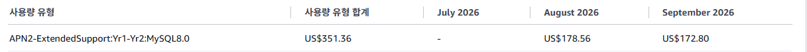

> 진단 포인트: 「RDS 요금이 갑자기 뛰었다」면 인스턴스·스토리지·백업 비용은 보통 고정이니, **사용량 유형별**로 쪼개 `ExtendedSupport` 항목부터 찾는다.

8.0 → 8.4 는 중간 버전을 거치지 않고 바로 올릴 수 있습니다.

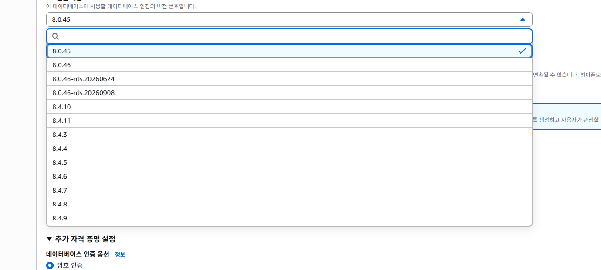

---

## 2. 방식 비교 — 왜 블루/그린인가

| 방식 | 다운타임 | 롤백 | 추가 비용 |
|---|---|---|---|
| 인플레이스 업그레이드 | 30~60분(여러 번 재시작) | 스냅샷 복원 — 느리고 사실상 비가역 | 없음 |
| **블루/그린 배포** | **전환 순간 약 1분** | **전환 전이면 그린만 지우면 끝** | 그린이 떠 있는 동안만 |
| 새 인스턴스로 덤프·이관 | 김 | 수동 | 새 인스턴스 + 앱 재배포(엔드포인트 변경) |

블루/그린을 고른 이유:
- **전환 전까지는 운영(블루)에 아무 영향이 없습니다.** 그린을 만들고 업그레이드하고 검증하는 동안 서비스는 그대로 돕니다.
- **문제가 생기면 전환하지 않으면 됩니다.** 인플레이스는 실패하면 스냅샷 복원뿐입니다.
- **엔드포인트가 그대로라** JDBC URL 변경·재배포가 필요 없습니다.
- 블루 → 그린 데이터는 AWS 가 복제로 계속 맞춰 주므로 덤프·이관이 없습니다.

---

## 3. 사전 검증 — 「무변경 전환」을 운영에 손대기 전에 확인

운영을 건드리지 않고, 비용 없이 세 가지를 봤습니다.

**① 인증 플러그인 — 가장 큰 위험**
- 앱 계정이 `mysql_native_password` 를 쓰고 있었습니다.
- 커뮤니티 MySQL 8.4 는 이 플러그인이 **기본으로 꺼져 있어**, 그대로 올리면 `Plugin 'mysql_native_password' is not loaded` 로 **로그인 불가 = 서비스 다운**입니다.
- 확인해 보니 **RDS 8.4 파라미터 그룹은 `mysql_native_password = ON` 을 기본값·수정 불가로 고정**해 둡니다. 기존 계정이 아무 조치 없이 로그인됩니다.
  로컬 Docker `mysql:8.4.11` 로 같은 상황을 재현해 확인했습니다.

**② JDBC 커넥터** — 운영 중인 구버전 Connector/J(8.0 계열)가 8.4.11 에 정상 접속 → 애플리케이션 재빌드 불필요.

**③ SQL 호환** — MyBatis 매퍼 XML 전수 검사. `SQL_CALC_FOUND_ROWS`·`FOUND_ROWS`, `PASSWORD`·`ENCRYPT`, `JSON_MERGE`, `ZEROFILL`, 옛 공간 함수 등
8.0 이후 제거·비권장된 패턴 0건, SQL 안의 charset·collation 하드코딩 0건, 매퍼 안 DDL 0건.

**결론: 계정·커넥터·파라미터·SQL 모두 손대지 않고 8.4 로 갈 수 있다.**

---

## 4. 작업 과정

### 4-1. 8.4 용 파라미터 그룹 만들기

⚠️ **엔진 유형을 Aurora MySQL 로 고르면 안 됩니다.** 일반 RDS 라서 **MySQL Community / 패밀리 `mysql8.4`** 여야 합니다. 이름이 비슷해 실제로 한 번 잘못 골랐습니다.

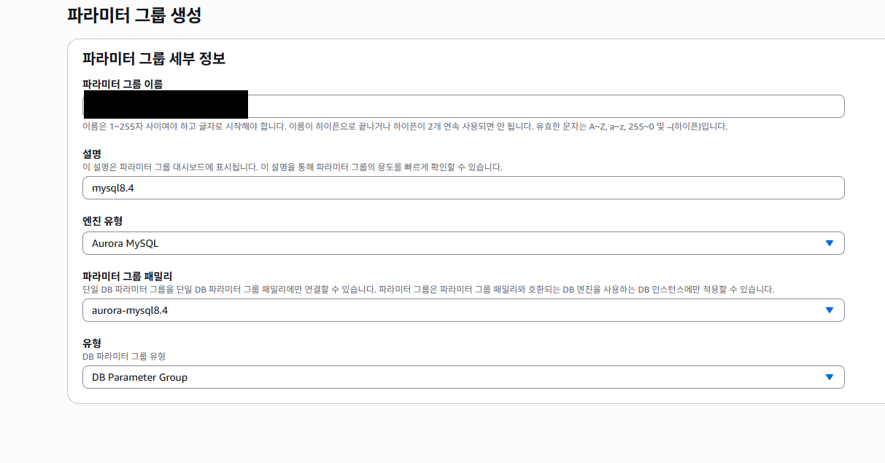

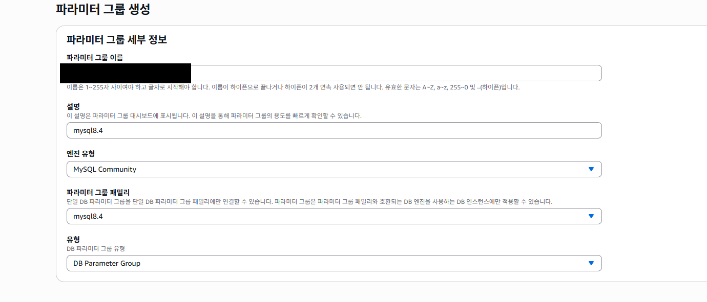

### 4-2. 운영에서 바꿔 둔 파라미터만 옮기기

8.0 운영 파라미터 그룹에서 **소스가 Modified 인 값만** 새 그룹에 그대로 넣었습니다. 이번엔 7개였습니다.

- `character_set_client` / `connection` / `database` / `filesystem` / `results` = utf8
- **`lower_case_table_names` = 1** — 정적 파라미터. **블루와 반드시 같아야 하고**, 다르면(기본값 0) 전환이 깨집니다. 가장 중요합니다.
- `time_zone` = Asia/Seoul

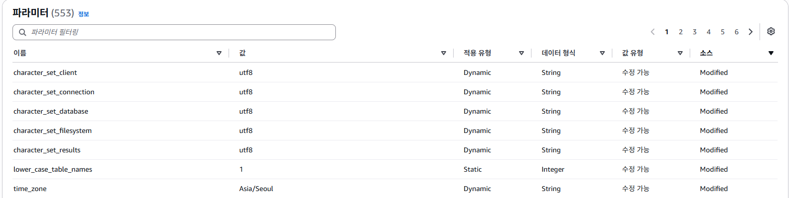

`mysql_native_password` 는 건드리지 않습니다(ON·수정 불가 고정). 나머지는 전부 기본값입니다.

### 4-3. 블루/그린 배포 만들기

운영 인스턴스에서 **작업 → 블루/그린 배포 생성**.

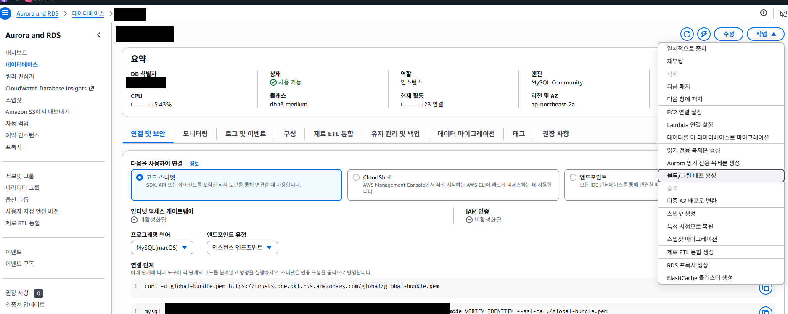

그린 쪽만 지정합니다.
- 엔진 버전: **MySQL 8.4.11**
- DB 파라미터 그룹: **4-1 에서 만든 커스텀 그룹**. 화면은 처음에 `default.mysql8.4` 가 골라져 있습니다(아래 스크린샷이 그 상태). **그대로 두면 `lower_case_table_names` 가 0 이 되어 전환이 깨지므로 반드시 바꿉니다.**
- 인스턴스 클래스·스토리지: 블루와 동일. 「최적화된 쓰기」「스토리지 파일 시스템 업그레이드」는 해제 — 바뀌는 변수를 엔진 버전 하나로 줄이기 위해서입니다.

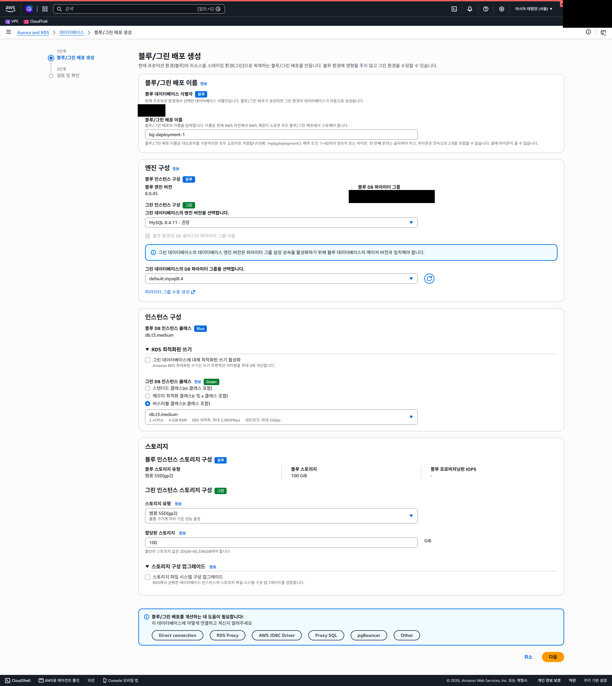

검토 화면에서 바뀌는 항목이 **엔진 버전과 파라미터 그룹 두 가지뿐인지** 확인합니다.

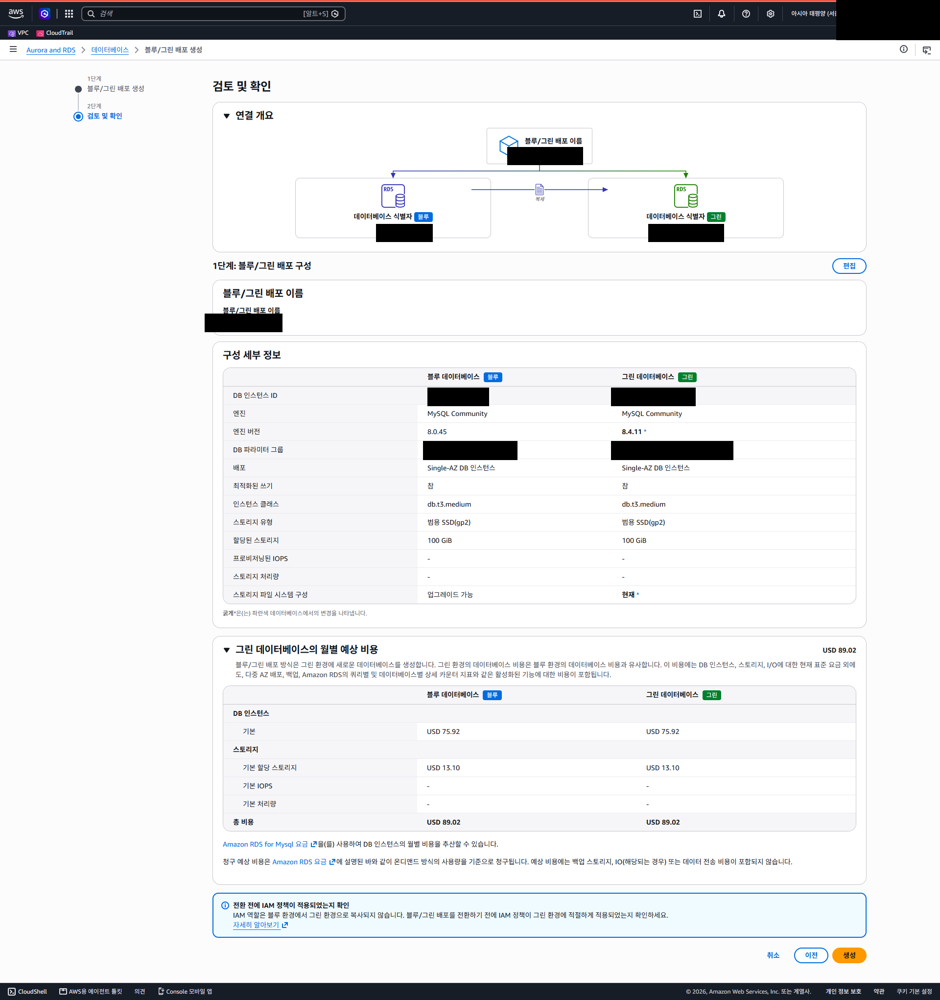

생성을 누르면 그린 생성 → 블루의 읽기 전용 복제본으로 연결 → 엔진 8.4 업그레이드 → 백업 구성이 자동으로 진행됩니다. **이 동안 다운타임은 없습니다.**

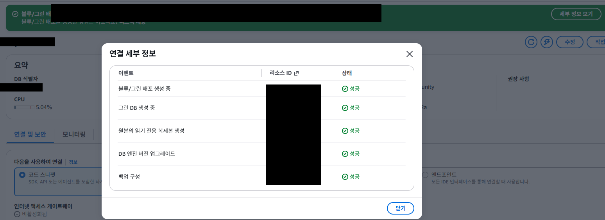

### 4-4. 그린이 블루와 같은지 확인

연결·보안 탭에서 보안 그룹·VPC·서브넷·포트가 블루에서 그대로 상속됐는지 봅니다. 콘솔이 「다른 설정」으로 알려 주는 것은 **엔진 버전 하나뿐**이었습니다.

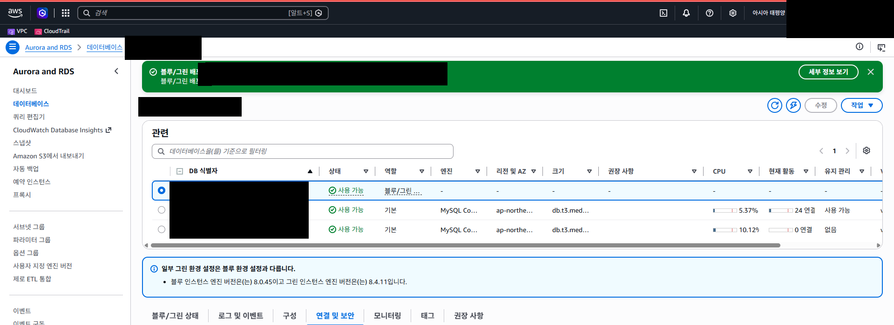

IAM 역할만은 그린으로 복사되지 않습니다. 이 서비스는 IAM DB 인증을 쓰지 않아 영향이 없었습니다.

### 4-5. 전환 전 그린 검증 — 핵심

전환하면 잠깐이라도 끊기니, 그 전에 **그린 임시 엔드포인트에 실제 서비스 계정으로 접속**해 두 가지를 확인했습니다.
- 서버 버전 = **8.4.11**
- `mysql_native_password` 계정 **로그인 성공** — 3장에서 문서·로컬로 확인한 「무변경」이 실제 그린에서도 성립하는지 최종 확인

로컬 PC 에서는 DB 에 직접 닿지 않아서, **운영 WAS 에 JDBC 테스트 클래스 하나와 커넥터 jar 를 임시로 올려 `java -cp` 로 한 번 접속한 뒤 지웠습니다.**
WAS 에 mysql 클라이언트가 없어도 JRE 만 있으면 되고, 운영 애플리케이션에는 손대지 않는 방법입니다.

### 4-6. 전환(switchover)

배포 항목 선택 → **작업 → 전환**. 제한 시간은 기본 5분 그대로 — 이 안에 못 끝나면 전환하지 않고 원래대로 돌아가는 안전장치입니다.

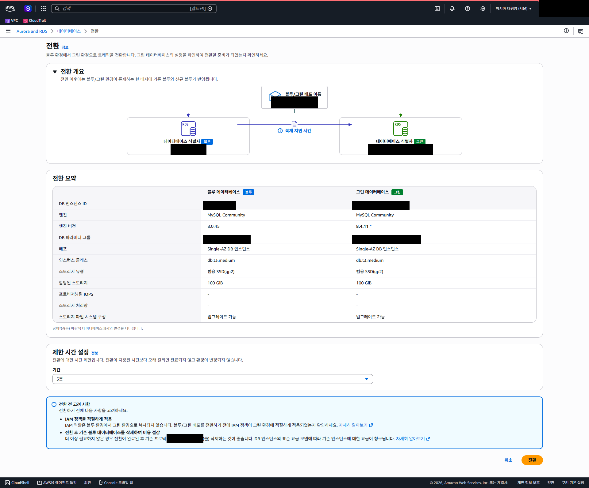

전환은 블루 쓰기를 잠깐 막고, 그린이 따라잡으면 그린을 운영으로 올립니다. **엔드포인트는 그대로이고 그린을 가리키게 바뀝니다.** 약 1분 걸렸습니다.

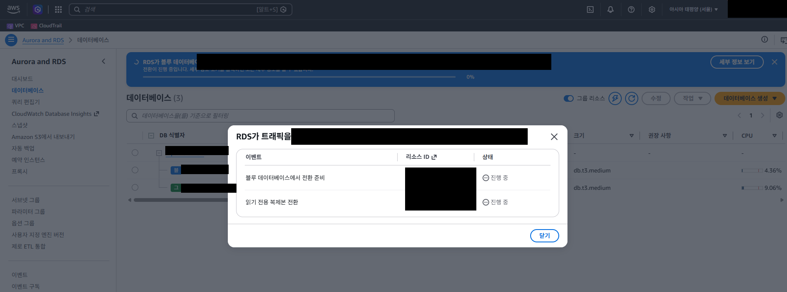

전환 뒤 운영 엔드포인트로 접속해 버전이 8.4.11 인지 다시 확인했습니다.

### 4-7. WAS 순차 재기동

이중화된 WAS 를 **한 대씩** 재기동했습니다. 커넥션 풀이 옛 블루 연결을 쥐고 있을 수 있어, 자동 재연결에 맡기지 않고 깨끗하게 다시 붙이기 위해서입니다.
각 WAS 마다 종료 → 프로세스 종료 확인 → 기동 → 포트 확인 → DB 를 타는 페이지 HTTP 200 + 로그에 DB·인증 오류 없음을 확인했습니다.

---

## 5. 마무리

1. **관찰 1~2일** — 옛 블루(8.0)를 롤백용으로 잠시 둡니다.
2. ⚠️ **옛 블루 삭제** — 옛 블루는 여전히 8.0 이라 **살아 있는 동안 확장 지원 요금이 계속 붙습니다.** 관찰이 끝나면 지워야 과금이 멈춥니다. 블루/그린 배포 항목도 정리합니다.
3. **청구서 확인** — 다음 청구서에서 `ExtendedSupport…MySQL8.0` 항목이 사라졌는지 봅니다.

---

## 6. 배운 것

- **비용이 튀면 사용량 유형별로 쪼갠다.** 변경 이력이 0건이어도 EOL 정책만으로 요금이 생깁니다.
- **파라미터 그룹 엔진은 MySQL Community / `mysql8.4`** — Aurora 와 헷갈리기 쉽습니다.
- **그린 파라미터 그룹을 기본값으로 두지 않는다.** 특히 정적 파라미터(`lower_case_table_names`)는 블루와 다르면 전환이 깨집니다. 운영에서 바꿔 둔 값만 옮긴 커스텀 그룹을 씁니다.
- **인증 플러그인을 가장 먼저 본다.** 커뮤니티 8.4 에서는 로그인 불가로 이어지는 변경이지만, RDS 는 ON 으로 고정해 둬서 무변경으로 넘어갔습니다.
  `mysql_native_password` 는 MySQL 9.x 에서 제거될 예정이라 중장기적으로 `caching_sha2_password` 전환과 커넥터 상향이 필요합니다.
- **전환 전 그린에 실제 계정으로 접속해 보는 것이 가장 확실한 안전장치다.** 직접 닿지 않으면 운영 WAS 를 거쳐 비침습적으로 확인합니다.
- **생성·검증은 언제 해도 되고, 전환만 저트래픽 시간에 하면 된다.** 블루/그린 생성 자체에는 다운타임이 없습니다.
- **옛 블루를 지우기 전까지 과금은 끝나지 않는다.** 관찰은 짧게 합니다.

---

## 7. 환경 (일반화)

- DB: AWS RDS for MySQL, Single-AZ, db.t3.medium, gp2 100GiB, ap-northeast-2
- 앱: Spring Boot(WAR) + MyBatis + HikariCP, Connector/J 8.0 계열, WAS 2대 이중화
- 그린 비용: 떠 있는 동안만 시간당 과금(월 환산 약 US$89)
